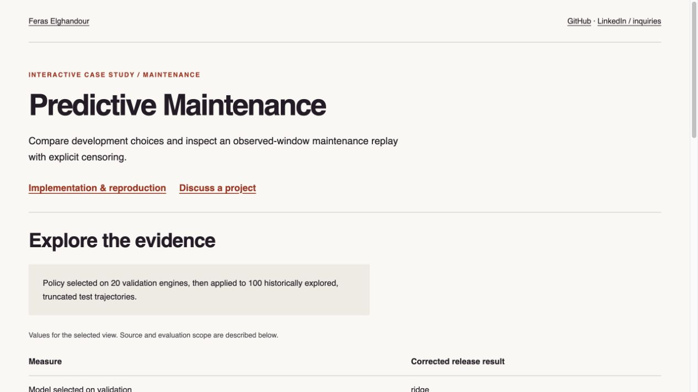

# Predictive Maintenance and Observed-Window Policy Evaluation

**Feras Elghandour**

Estimate remaining engine life and translate predictions into an inspectable maintenance policy, with validation-selected decisions and explicit treatment of truncated records.

**[Explore the interactive report](https://feraselghandour.github.io/predictive-maintenance/)** · [Evaluation record](artifacts/release_validation.json) · [Operating scope](OPERATIONS.md)

[](https://feraselghandour.github.io/predictive-maintenance/)

## Problem and implementation

Maintenance decisions depend on warning lead time, early interventions, and failures that a prediction never reaches. This project builds causal sensor features, compares a scaled Ridge baseline with a random forest, and evaluates a threshold policy using whole-engine splits.

The drift reference uses the mean of observations available so far during the first five cycles, then freezes. Model selection uses 20 validation engines; policy selection minimizes validation late/missed calls, then early interventions. Test outcomes do not select the threshold.

## Corrected release evidence

| Measure | Result |
|---|---:|
| Development / validation engines | 80 / 20 |
| Validation-selected model | ridge |
| Validation-selected health threshold | 45% |
| Historical test endpoint MAE | 13.44 cycles |
| Test engines entering the observed policy danger window | 35 / 100 |
| Censored before entering that window | 65 / 100 |
| Misses within observed eligible windows | 5 / 35 |
| Late warnings / early interventions | 0 / 1 |

The corrected evaluation supersedes the earlier zero-miss headline. That earlier policy was justified using the test-cohort sweep. Historical artifacts remain available for comparison, but they do not constitute independent final validation. FD001 itself was explored previously, so this correction is not a new untouched external benchmark.

## Reproduce

```sh
python -m venv .venv
. .venv/bin/activate
python -m pip install -r requirements-release.txt
python run.py
python -m pytest -q
```

`run.py` executes the corrected protocol and rebuilds the report. Source and input SHA-256 fingerprints are recorded with the result. The original optional LSTM research implementation remains under `src/models.py`; it is not part of the corrected two-model comparison.

## Practical relevance and limits

The method separates prediction quality from the cost and timing of intervention. The NASA C-MAPSS FD001 benchmark contains simulated turbofan degradation under one operating condition and one fault mode. Test histories stop before failure. No prospective fleet benefit, eventual failure coverage, conversion from cycles to calendar time, or aviation safety certification is claimed.

Before operational deployment, validate on prospective fleet records, agree intervention costs and lead times, assess drift and uncertainty, and integrate a human maintenance review.

[Portfolio](https://feraselghandour.github.io/) · [Professional inquiries](https://www.linkedin.com/in/feras-elghandour/)
